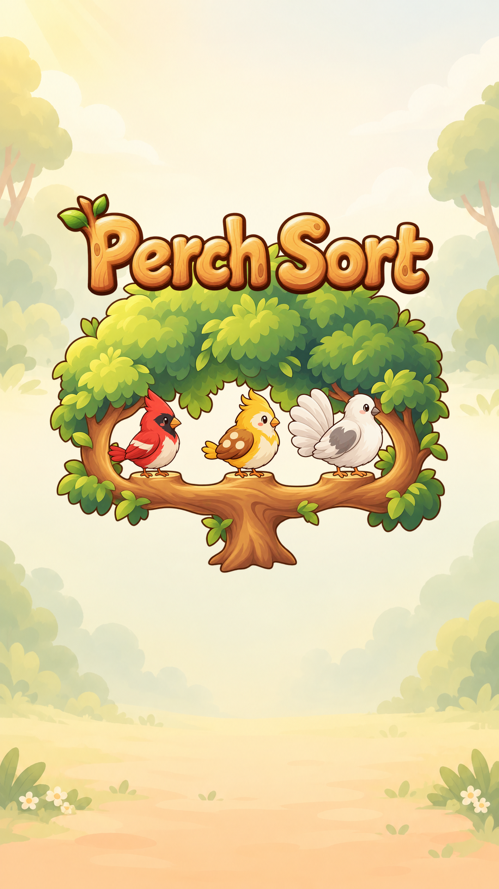
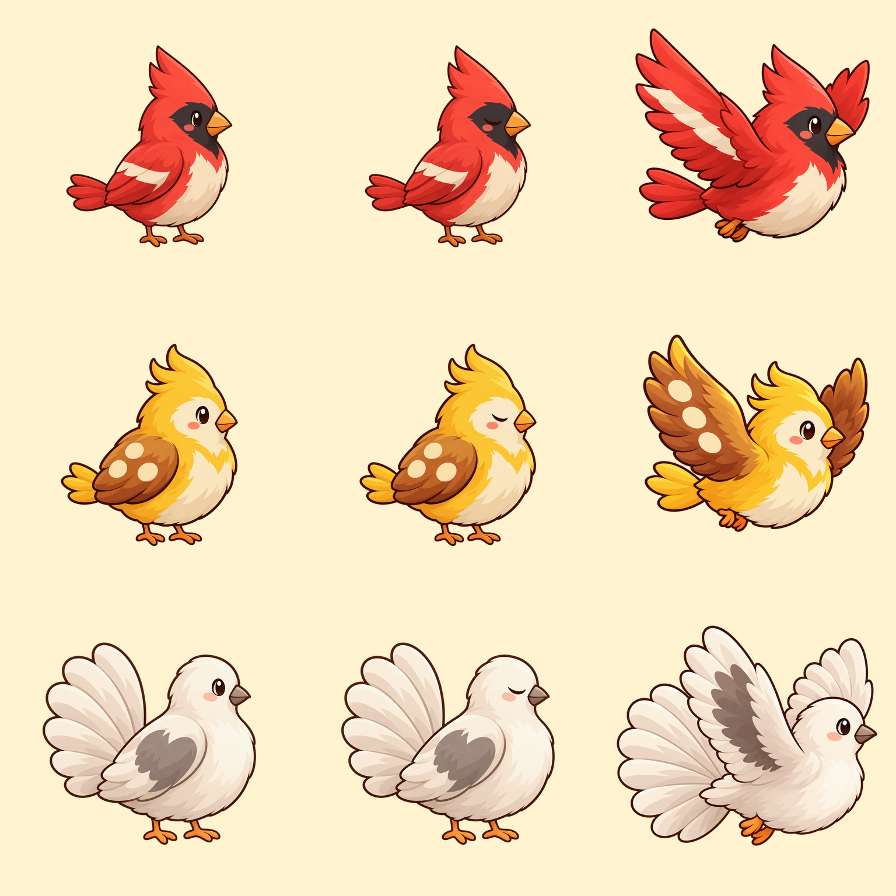

# T11b3 主菜单美术交付报告

状态：🟡 已交付待验收。任务内素材与离线合成验证完成，整体美术验收由 Claude 执行；未改运行时代码、未做 Unity 接入或动态验收，未提交 git。

## 交付

全部最终素材位于 `art/ui_kit/`，仅另写本报告；未修改 `art/raw/`、`art/source/` 或 `PerchSort/`。

| 文件 | 尺寸 | 用途 |
|---|---|---|
| `logo_perch_sort.png` | 1536×640 | 原创圆润木质描边英文 Logo，仅 Perch Sort，两片小叶 |
| `menu_tree.png` | 1536×1280 | 透明树冠、粗枝、三个空栖位，不含鸟 |
| `blink_bird_01.png` | 1024×1024 | 红鸟闭眼局部叠片 |
| `blink_bird_03.png` | 1024×1024 | 黄鸟闭眼局部叠片 |
| `blink_bird_05.png` | 1024×1024 | 白鸟闭眼局部叠片 |
| `fly_bird_01.png` | 1024×1024 | 红鸟朝右展翅姿态 |
| `fly_bird_03.png` | 1024×1024 | 黄鸟朝右展翅姿态 |
| `fly_bird_05.png` | 1024×1024 | 白鸟朝右展翅姿态 |
| `manifest_menu.json` | JSON | 画布尺寸、脚底坐标、UV、Unity pivot、叠片方式、SHA-256、预览构图 |
| `contact_menu.png` | 1080×1920 | 原森林背景上的实际素材合成预览 |
| `review_menu_birds.png` | 1536×1536 | 角色一致性验收图：各行依次 01/03/05，各列依次原站姿/闭眼叠合/展翅 |

预览：

## 站位与使用

树冠坐标原点为图片左上，x 向右、y 向下，单位像素。脚底锚点指两脚落地基线的中心。

| 角色 | 树图脚底坐标 | 原鸟图脚底锚点 | 预览鸟画布左上角 |
|---|---|---|---|
| bird_01 | (418,896) | (594,860) | (178,803) |
| bird_03 | (768,896) | (584,860) | (386,803) |
| bird_05 | (1135,896) | (622,860) | (591,803) |

鸟的原始画布均为 1024×1024，预览显示为 270×270；实际角色轮廓高度约 195px。`manifest_menu.json` 同时给出归一化位置及左下原点的 Unity pivot，避免 y 轴方向混淆。

闭眼文件是**透明眼部叠片**，不是完整鸟图；必须与 `art/raw/birds/bird_NN.png` 使用完全相同的画布、pivot、缩放、位移和 tint，再做 source-over 叠加。不要单独 Trim/自动裁剪眼部图片，不要根据叠片可见包围盒重新居中。闭眼时显示、睁眼时隐藏；无需整鸟替换，因此无姿态跳动。

每只飞鸟仅一张朝右展翅姿态，不是振翅序列。飞出/飞回、歪头、轮流眨眼、Reduce motion 等仍由 UI 集成任务实现。

## 验证结果

- 八张独立素材全部为 RGBA PNG，alpha 范围均为 0–255，具真实透明通道；菜单预览使用不透明背景，alpha 为 255。
- Logo 与树图尺寸分别精确为 1536×640、1536×1280；六张鸟变体精确为 1024×1024，与原鸟画布一致。
- 闭眼图来自 image_gen 原鸟编辑结果，Pillow 只提取/羽化眼部局部，其他区域全透明。将叠片合成到原鸟并做像素差分，三只鸟在对应眼部包围盒以外全部逐像素不变。初版黄/白鸟下眼缘残影已扩大眼部遮罩消除，并放大检视最终合成。
- 已实际查看 `contact_menu.png`：三只鸟脚底落在三个独立栖位上，未互相遮挡；Logo 文案正确，装饰仅两片叶，无其他文字。
- 已实际查看 `review_menu_birds.png`：红鸟保留红色凤头、深色面罩、奶油翅纹；黄鸟保留金色三簇凤头及三枚奶油圆斑；白鸟保留象牙白扇尾和灰褐色翅斑。三张展翅图朝右且翅尾完整。
- 未以离线 PNG 检查替代目标运行时验收；Claude 仍需审美确认，后续集成需验证实际动画、字幕/按钮空间及三种目标屏幕比例。

## 已确认的制作细节与偏离记录

协调者 `msg_79cc710e33d8` 明确确认：允许 Pillow 仅做画布尺寸规范化、闭眼眼部局部合成并保持其余像素不变，以及用真实素材生成预览；同意预览 1080×1920、Logo 宽 860 中心 y=+420、树冠宽 900 中心 y=+80，预览只含 Logo/树/三鸟/原背景。

执行结果：Logo 显示画布 860×358，中心 (0,+420)；树冠显示画布 900×750，中心 (0,+80)。背景直接使用 `art/raw/env/background.png`。树图规范化时保留约 24px 左右透明边，防止素材边缘紧贴画布；三个站位由最终枝面位置记录。

无未批准的设计偏离。按任务要求不输出副标题图片或 `logo_subtitle_none`，不在 Logo 内画副标题；预览省略副标题/按钮/进度属于上述已确认范围，不表示完整主菜单 UI 已验收。另附角色对照图只用于验收证据。

## 生成方式与最终提示词集

使用内置 **image_gen**（`image_gen.imagegen`），未使用 API/CLI 替代模型。所有生成调用均 `transparent_background=true`。原鸟均先实际打开检视，以其作为 identity/style reference；Logo、树冠另参考原森林背景。生成后用经协调者授权的 Pillow 做指定尺寸规范化、眼部叠片和真实素材合成。

以下记录每次生成提示词的完整语义与固定约束；各鸟分别调用，未用一张合图切出角色：

- **Logo 初稿 / logo-brand**：one original game logo asset on genuine transparent background; references are STYLE only; exact text “Perch Sort” only; 1536×640 wide canvas; warm handmade forest cartoon; rounded cute thick outlined letters carved from honey-colored wood and branches; cream highlights, restrained wood grain, warm brown outline #5A3A22, upper-left soft lighting, subtle lower-right shade; one readable horizontal line with P-e-r-c-h space S-o-r-t; two tiny green leaves; original lettering, no existing game logo resemblance; generous transparent edge padding; no subtitle, other words, bird, scene or rectangle.
- **Logo 最终修正 / precise-object-edit**：keep the Perch Sort wooden lettering logo exactly; remove the TWO green leaves on the far RIGHT above/beside t; keep only the TWO on LEFT above P; transparent space replaces removed leaves; preserve letters, exact text, wood shapes/grain, palette, outlines, left leaves, framing; transparent background, target 1536×640; no other changes.
- **树冠 / stylized-concept**：one isolated transparent 2D game menu tree sprite, 1536×1280; match reference warm hand-painted cartoon forest colors; broad rounded green crown and thick honey-brown branches, short central trunk; canopy upper half/sides, three spacious windows below for overlaid birds; main thick gently curving branch near 72% image height, three unobstructed flat perch tops near x=25/50/75%, clear space above each; NO BIRDS; warm brown outline #5A3A22, organic forms, painted leaf clumps, upper-left highlights and soft lower-right shading; fully in frame, transparent padding and spaces between branches; no ground, grass platform, scene, words, numbers, or seat markers.
- **闭眼通用 / precise-object-edit**：edit this exact bird_NN sprite into its blink frame; change ONLY visible eye: remove open brown eye and white catchlight, replace with gentle closed downward-curving warm dark brown eyelid stroke in same eye position; keep original 1024×1024 canvas, exact silhouette, size, position and every other feature; single animation frame overlay source; no reposition, zoom or restyling; transparent background; one complete full-body bird facing RIGHT; no text.
- **闭眼 01 身份约束**：charcoal face patch, same crest/beak/colors/feather shapes/tail/cream wing stripe/feet.
- **闭眼 03 身份约束**：cream face patch, three golden crest tufts, orange beak, yellow gold colors, brown wing with THREE cream round spots, same feathers/tail/cream belly/orange feet.
- **闭眼 05 身份约束**：ivory face/plumage, giant fan-shaped cream tail on left, gray-brown wing patch, gray-brown beak, pink blush, same feathers/orange feet.
- **飞行通用 / identity-preserve**：one flying animation sprite of this EXACT bird character; flying RIGHT with head/beak RIGHT; BOTH wings spread in cheerful upstroke, front wing upward-left and rear wing visible above back, feet tucked; preserve character identity, cute warm hand-painted proportions, dark warm brown outlines, upper-left highlights; whole bird/wings/tail in frame with clear transparent padding; target 1024×1024 square; no branch, scene, text, motion streaks or second bird; same character in flight, not new species.
- **飞行 01 身份约束**：red cardinal; distinctive cream diagonal front-wing stripe; pointed red crest, charcoal face/throat, shiny brown eye, pink cheek, orange beak/feet, plump cream belly, red tail/palette.
- **飞行 03 身份约束**：yellow golden bird; THREE LARGE CREAM ROUND SPOTS on warm brown front-wing feathers; three gold crest tufts, cream face/belly, shiny brown eye, pink cheek, golden tail, orange beak/feet.
- **飞行 05 身份约束**：ivory fan-tail bird; large warm-gray front-wing patch surrounded by ivory feathers, rear ivory wing; soft rounded white head, shiny brown eye, pink cheek, gray-brown beak, creamy belly, huge rounded fan-shaped cream tail spread LEFT, subtle beige shading, orange feet.

生成原始文件保留于 `/Users/apple/.codex/generated_images/01a19125-9e90-7890-8c9a-6180ca194587/`；交付使用的全部最终素材已经独立保存到仓库目录，无需运行时引用该生成目录。

| 最终资产来源 | 原始生成文件 |
|---|---|
| Logo | `exec-ad0c3bf9-462e-4597-83b1-14c0c4c26dd3.png` |
| 树冠 | `exec-565fe60b-e1d0-421b-9f0f-784b8a2c6f74.png` |
| blink 01 局部来源 | `exec-9a51613b-fef8-4980-8b6b-79c7e18a0bae.png` |
| blink 03 局部来源 | `exec-d24c7a76-a6ed-474a-b82b-49a07b15921f.png` |
| blink 05 局部来源 | `exec-04fa0950-b6be-44c3-ba20-966d796a77cc.png` |
| fly 01 | `exec-233ffa26-7321-4e00-99b3-50366d29f050.png` |
| fly 03 | `exec-792918f3-7f83-43ac-b679-31807ba27e5c.png` |
| fly 05 | `exec-c7576de6-0872-42ed-a958-6fedef18a3d7.png` |
